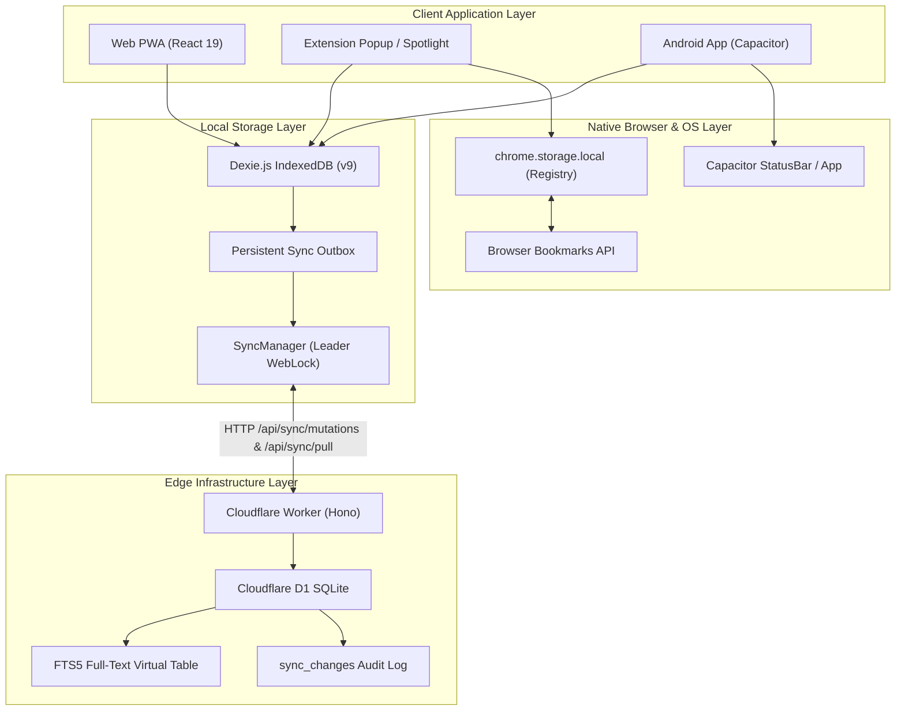

# Markbel Architecture Contracts, System Invariants & Blast-Radius Governance

**Audience:** AI Coding Agents (Antigravity, Gemini, Claude, Cursor) & Staff Software Engineers  
**Status:** Canonical & Mandatory  
**Version:** 2.5.17+  
**Last Updated:** November 2026  

---

## 1. Executive Mandate

Markbel is a **Local-First, Zero-Latency, Distributed Bookmark Vault** spanning five interdependent runtime environments:
1. **Web Single-Page App (SPA / PWA):** React 19, Tailwind CSS v4, Framer Motion, Workbox.
2. **Client-Side Storage Engine:** Dexie.js (IndexedDB) with multi-tab WebLocks and offline outbox.
3. **Edge Cloud Backend:** Cloudflare Workers (Hono framework) with D1 Serverless SQLite and FTS5.
4. **Browser Extensions:** Chromium (Manifest V3) & Firefox (Manifest V3) with background service workers.
5. **Native Mobile App:** Capacitor Android with native plugins, status bar bridge, and system share sheet.

> [!CAUTION]
> **The Golden Law of Markbel Engineering:**
> A modification to any one subsystem almost always exerts a cascading blast radius across other subsystems. **Never modify, delete, or refactor code in one layer without consulting the Cross-Subsystem Contracts and Blast-Radius Checklists in this document.**

---

## 2. Cross-Subsystem Dependency Graph



---

## 3. The 10 Iron Architectural Invariants (Never Break These)

### Invariant 1: Dexie Schema Versioning & Composite Keys
- **Rule:** Never modify existing `this.version(N).stores({...})` definitions. Always append `this.version(N + 1).stores({...})`.
- **Primary Key Invariant:** The first token before the first comma in Dexie store definitions is the **primary key**. When storing child or many-to-many entities (such as `articleTokens`), **always use composite keys** (e.g. `'[token+bookmarkId], token, bookmarkId'`).
- **Migration Invariant:** Every schema bump that introduces new indexable tables or shifts data shapes must include an explicit `.upgrade(async (tx) => { ... })` hook to populate existing data.
- **File Reference:** [`src/db/db.ts`](file:///d:/dev/projects/markbel/src/db/db.ts)

### Invariant 2: D1 SQLite Ingestion Upsert & Idempotency
- **Rule:** Never execute raw `INSERT INTO bookmarks (...)` without conflict resolution in `/api/sync/mutations`.
- **Reason:** In Cloudflare D1, batch statements execute inside an atomic transaction. A single duplicate primary key violation (`SQLITE_CONSTRAINT: UNIQUE constraint failed: bookmarks.id`) causes all mutations in the batch to fail with HTTP 500, trapping the client in an infinite exponential retry loop.
- **Contract:** Always execute `INSERT INTO ... ON CONFLICT(id) DO UPDATE SET ... WHERE excluded.version >= bookmarks.version` combined with Last-Write-Wins (LWW) evaluation.
- **File Reference:** [`worker/src/routes/sync.ts`](file:///d:/dev/projects/markbel/worker/src/routes/sync.ts)

### Invariant 3: FTS5 Virtual Table Soft-Delete Hygiene
- **Rule:** Never allow soft-deleted records (`deleted_at IS NOT NULL`) to persist or be re-inserted into the `bookmarks_fts` virtual table.
- **Contract:** The `bookmarks_au AFTER UPDATE ON bookmarks` trigger must enforce:
  ```sql
  INSERT INTO bookmarks_fts (id, user_id, title, description, site_name, article_content)
  SELECT new.id, new.user_id, new.title, new.description, new.site_name, COALESCE(new.article_content, '')
  WHERE new.deleted_at IS NULL;
  ```
- **File Reference:** [`worker/schema.sql`](file:///d:/dev/projects/markbel/worker/schema.sql)

### Invariant 4: Extension Manifest V3 Message Channel Hygiene
- **Rule:** In `chrome.runtime.onMessage.addListener`, strictly return `true` **only** within branches that execute an asynchronous response (`sendResponse(...)`). Return `false` or `undefined` for synchronous or unhandled messages.
- **Reason:** Unconditional `return true` keeps the message channel port open until Chrome's internal timeout, triggering console errors: `Uncaught (in promise) Error: Could not establish connection. Receiving end does not exist`.
- **File Reference:** [`extension/src/background.ts`](file:///d:/dev/projects/markbel/extension/src/background.ts)

### Invariant 5: Extension MV3 CSP Compliance (Zero Inline Handlers)
- **Rule:** Never inject HTML strings containing inline event attributes (`onerror="..."`, `onclick="..."`, `onload="..."`).
- **Reason:** Chromium Manifest V3 enforces `script-src 'self'`. Blink/V8 evaluates inline attributes as unsafe code, throwing CSP violations in `helium://extensions` or `chrome://extensions`.
- **Contract:** Always attach DOM event listeners via standard JavaScript APIs (`img.addEventListener('error', ..., { once: true })`) immediately after setting `innerHTML`.
- **File Reference:** [`extension/src/popup/popupSearchView.ts`](file:///d:/dev/projects/markbel/extension/src/popup/popupSearchView.ts), [`extension/src/spotlight/MarkbelSpotlight.ts`](file:///d:/dev/projects/markbel/extension/src/spotlight/MarkbelSpotlight.ts)

### Invariant 6: Native Browser Bookmark Deletion Registry
- **Rule:** Never rely on `removeInfo.node` in `chrome.bookmarks.onRemoved`.
- **Reason:** Standard Chromium, Helium, and Firefox do not populate `removeInfo.node` because the node is deleted before the listener fires.
- **Contract:** Maintain a persistent `browserNodeIdToUrlMap` in `chrome.storage.local`. On `onRemoved(id, removeInfo)`, retrieve the target URL by `id` from the registry, execute local soft-deletion, and remove the entry from storage.
- **File Reference:** [`extension/src/bookmarkSync.ts`](file:///d:/dev/projects/markbel/extension/src/bookmarkSync.ts)

### Invariant 7: Edge SSRF Security Gateway
- **Rule:** Every outbound HTTP request issued from Cloudflare Workers (link health checks, metadata scraping, image proxy) must pass through [`isSafePublicUrl(url)`](file:///d:/dev/projects/markbel/src/lib/urlSafety.ts).
- **Reason:** Prevents Server-Side Request Forgery against cloud metadata endpoints (`169.254.169.254`), container interfaces, or internal network loopbacks (`127.0.0.1`, `10.0.0.0/8`, `172.16.0.0/12`, `192.168.0.0/16`).
- **File Reference:** [`worker/src/lib/linkHealth.ts`](file:///d:/dev/projects/markbel/worker/src/lib/linkHealth.ts), [`worker/src/routes/media.ts`](file:///d:/dev/projects/markbel/worker/src/routes/media.ts)

### Invariant 8: Multi-Tab WebLock & Leader Election
- **Rule:** Only the single elected leader tab can run periodic sync loops (`navigator.locks.request('markbel-sync-leader')`).
- **Contract:** Follower tabs must remain passive and delegate sync requests to the leader via `BroadcastChannel('markbel-sync-channel')`. When a leader tab closes, lock release must be immediate via `AbortController` bound to `beforeunload` and `pagehide`.
- **File Reference:** [`src/sync/SyncManager.ts`](file:///d:/dev/projects/markbel/src/sync/SyncManager.ts), [`src/db/adapters/WebEnvironment.ts`](file:///d:/dev/projects/markbel/src/db/adapters/WebEnvironment.ts)

### Invariant 9: Mobile & PWA Persistent Storage Exemption
- **Rule:** Always invoke `navigator.storage.persist()` on app cold boot.
- **Reason:** Mobile operating systems (Android WebView, iOS WebKit) silently wipe non-persisted IndexedDB databases when device free space drops below threshold.
- **Contract:** Call `if (navigator.storage?.persist) navigator.storage.persist();` in `src/main.tsx`.
- **PWA Manifest Contract:** VitePWA dynamically injects `manifest.webmanifest`. Never include a static `<link rel="manifest" href="/manifest.json">` in `index.html` to avoid duplicate manifest parsing collisions.
- **File Reference:** [`src/main.tsx`](file:///d:/dev/projects/markbel/src/main.tsx), [`index.html`](file:///d:/dev/projects/markbel/index.html), [`vite.config.ts`](file:///d:/dev/projects/markbel/vite.config.ts)

### Invariant 10: Atomic Semantic Version Synchronization
- **Rule:** Semantic version bumps are strictly atomic across all clients and platforms. A version bump must update all **9 synchronization targets simultaneously**:
  1. `package.json` (`version`)
  2. `packages/mcp/package.json` (`version`)
  3. `packages/mcp/src/index.ts` (`server.name` / version)
  4. `extension/manifest.json` (`version`)
  5. `extension/manifest.firefox.json` (`version`)
  6. `index.html` (JSON-LD schema `softwareVersion`)
  7. `public/llms.txt` and `public/llms-full.txt` (header and URLs)
  8. `android/app/build.gradle` (`versionCode` + `versionName`) and `twa-manifest.json`
  9. `src/components/modals/ReleaseNotesModal.tsx` and `src/views/LandingPage.tsx` (announcement banner)

---

## 4. Blast-Radius Checklists for Modifying Subsystems

When an engineer or AI agent is tasked with making changes, consult the relevant checklist below:

### Checklist A: Modifying Bookmark or Group Data Fields
If you add, rename, or delete a field on a Bookmark or Group:
- [ ] Update TypeScript interface in [`src/db/db.ts`](file:///d:/dev/projects/markbel/src/db/db.ts) (`LocalBookmark` / `LocalGroup`).
- [ ] If the field needs indexing, append a new `this.version(N + 1)` in `src/db/db.ts`.
- [ ] Update SQLite table schema in [`worker/schema.sql`](file:///d:/dev/projects/markbel/worker/schema.sql).
- [ ] Update normalization mapping in [`worker/src/normalize.ts`](file:///d:/dev/projects/markbel/worker/src/normalize.ts).
- [ ] Update push mutation statements in [`worker/src/routes/sync.ts`](file:///d:/dev/projects/markbel/worker/src/routes/sync.ts).
- [ ] Update agent API endpoints in [`worker/src/routes/agent/bookmarks.ts`](file:///d:/dev/projects/markbel/worker/src/routes/agent/bookmarks.ts).
- [ ] Update MCP tool schemas in [`packages/mcp/src/index.ts`](file:///d:/dev/projects/markbel/packages/mcp/src/index.ts).
- [ ] Run `npm test` to verify all 41 test suites pass.

### Checklist B: Modifying the Browser Extension
If you modify extension background, content, popup, or options scripts:
- [ ] Verify zero inline event handlers (`on[a-z]+=`) exist in any template string.
- [ ] Verify content script remains IIFE-compatible (`vite.config.extension.ts` bundle format).
- [ ] Run `npm run build:extension:all`.
- [ ] Mirror files to unpacked test directory: `Copy-Item -Path 'dist-extension\*' -Destination 'D:\dev\tools\markbel-extension\' -Recurse -Force`.
- [ ] Mirror files to canonical setup directory: `Copy-Item -Path 'dist-extension\*' -Destination 'D:\apps\0-setup\markbel-extension\' -Recurse -Force`.
- [ ] Reload extension in Helium / Chrome (`helium://extensions`), inspect Errors tab, and verify 0 errors.

### Checklist C: Modifying Edge Worker Backend or D1 Database
If you modify route handlers, middleware, or database schema:
- [ ] Test locally using `npx wrangler dev worker/src/index.ts`.
- [ ] If `worker/schema.sql` changed, run local migration: `npm run d1:migrate:local`.
- [ ] Deploy to Cloudflare Edge: `npx wrangler deploy`.
- [ ] If remote schema changed, run remote migration: `npm run d1:migrate:remote`.

---

## 5. Mandatory Verification Gates Before Declaring Tasks Done

```bash
# 1. Vitest Unit & Integration Suite (AAA Pattern - 536+ tests)
npm test

# 2. TypeScript Static Analysis (0 compilation errors)
npm run typecheck

# 3. Production PWA Build (Workbox Precache verification)
npm run build

# 4. Multi-Platform Extension Packaging
npm run build:extension:all

# 5. Mirror to Unpacked Test Directory
pwsh -NoProfile -Command "Copy-Item -Path 'dist-extension\*' -Destination 'D:\dev\tools\markbel-extension\' -Recurse -Force"
pwsh -NoProfile -Command "Copy-Item -Path 'dist-extension\*' -Destination 'D:\apps\0-setup\markbel-extension\' -Recurse -Force"
```
