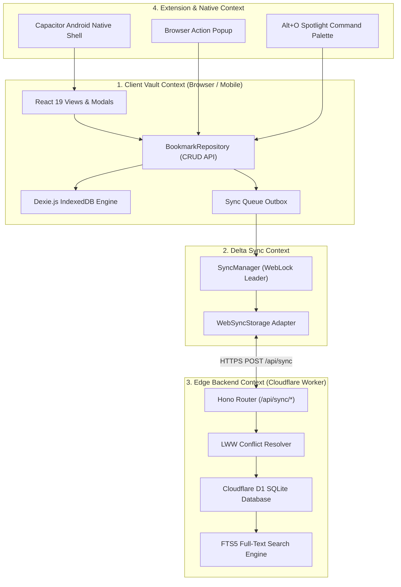
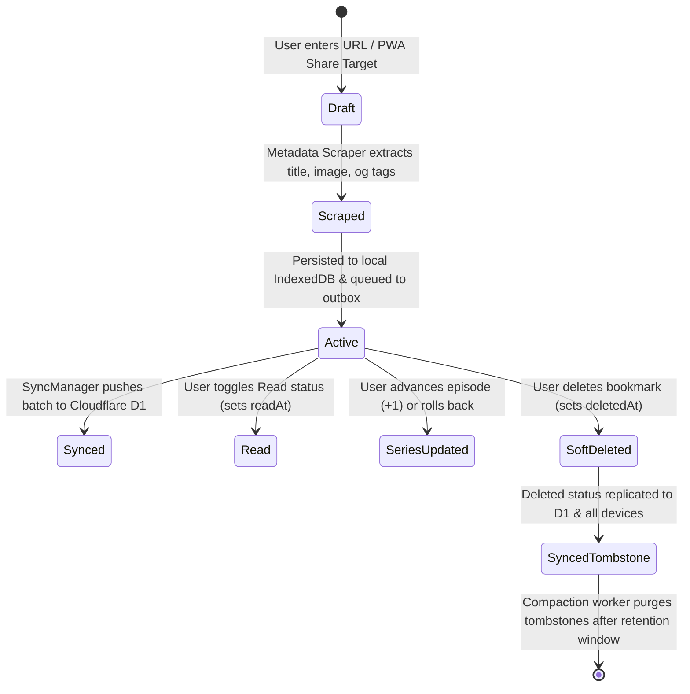

# Markbel — Ubiquitous Domain Language & Entity Model (CONTEXT.md)

**Domain:** High-Speed, Offline-First Bookmark Vault & Rich Media Archiver  
**Audience:** Software Engineers & AI Pair Programmers (Antigravity, Gemini, Claude, Cursor)  
**Status:** Canonical Domain Vocabulary  
**Version:** 2.9.4+ (November 2026)

---

## 1. Core Domain Entities

### `LocalBookmark`
The primary aggregate entity representing a captured URL, its descriptive metadata, presentation states, series progression, and sync tracking.
- **Canonical Terms:** Bookmark, LocalBookmark, Vault Entry.
- **_Avoid:_** Link item, saved record, URL object, bookmark row.
- **Key Attributes:**
  - `id`: Globally unique UUID v4 string.
  - `url`: Canonical, normalized target destination URL.
  - `title`: User-defined or auto-scraped display title.
  - `description`: Extracted summary text or user annotation.
  - `image`: URL of high-resolution preview poster, thumbnail, or extracted cover.
  - `favicon`: URL of domain icon or public favicon service fallback.
  - `group`: Categorical assignment (e.g. `'Engineering'`, `'Design'`, `'Unsorted'`).
  - `contentType`: Detected media classification (`'article'`, `'video'`, `'playlist'`, `'audio'`, `'image'`, `'website'`).
  - `isPinned`: Boolean flag indicating whether entry is locked to the top of list/grid feeds.
  - `isRead`: Boolean flag indicating whether user has read/consumed the bookmark.
  - `readAt`: ISO 8601 timestamp when bookmark was marked read.
  - `remindAt`: ISO 8601 timestamp for scheduled reminder push/notification.
  - `seriesKey`: Normalized series identifier for serialized media (anime, manga, tutorial series).
  - `seriesEpisode`: Current episode or chapter integer.
  - `seriesSeason`: Optional season integer.
  - `seriesHistory`: Array of historical series progression states.
  - `ticktickTaskId`: External TickTick task ID linked to this bookmark.
  - `ticktickProjectId`: External TickTick project/list ID.
  - `ticktickSyncStatus`: Status of TickTick synchronization (`'pending'`, `'synced'`, `'failed'`).
  - `version`: Monotonically increasing revision integer used for Last-Write-Wins (LWW) conflict resolution.
  - `createdAt`: ISO 8601 creation timestamp.
  - `updatedAt`: ISO 8601 last modified timestamp.
  - `deletedAt`: Optional ISO 8601 tombstone timestamp for soft deletion.

### `LocalGroup`
A collection grouping or category tag that segments bookmarks into semantic pillars.
- **Canonical Terms:** Group, Category, Pillar.
- **_Avoid:_** Folder, tag group, directory, collection label.
- **Key Attributes:**
  - `id`: Unique identifier string.
  - `name`: Human-readable unique display name (e.g., `'Engineering'`, `'Reading List'`).
  - `color`: CSS or design token color string for badge rendering.
  - `icon`: Lucide icon identifier string.
  - `order`: Numeric sort weight for sidebar ordering.

### `SyncBatch`
A packaged bundle of client mutations or remote delta changes exchanged over the sync protocol.
- **Canonical Terms:** SyncBatch, Mutation Batch, Delta Bundle.
- **_Avoid:_** Payload, sync packet, update dump.
- **Key Attributes:**
  - `clientId`: Stable unique device or client installation identifier.
  - `changes`: Array of individual `SyncChange` mutation records.
  - `cursor`: High-water mark timestamp or sequence identifier for incremental pull replay.

### `SyncChange`
An atomic change record capturing a create, update, or soft-delete operation.
- **Canonical Terms:** SyncChange, Change Log Entry, Mutation Record.
- **_Avoid:_** Diff, transaction record, delta item.
- **Operations:** `'insert'`, `'update'`, `'delete'`.

---

## 2. Bounded Contexts & Subsystems

---

## 3. Ubiquitous Vocabulary Matrix

| Term | Definition | Context | Avoid (Do Not Use) |
| :--- | :--- | :--- | :--- |
| **Local-First** | Architecture where reads, writes, and queries execute entirely against local IndexedDB with zero network latency, synchronizing lazily with edge storage. | Storage / Architecture | Client-Server only, Offline cache only |
| **Soft Delete** | Marking a bookmark with `deletedAt: <timestamp>` rather than immediately purging rows, allowing tombstones to replicate across all synchronized devices. | Database / Sync | Hard delete, row purge, record destroy |
| **Last-Write-Wins (LWW)** | Deterministic conflict resolution strategy comparing numeric `version` and `updatedAt` timestamps during synchronization. | Synchronization | First-in first-out, manual merge conflict |
| **WebLock Leader** | Browser Web Locks API mechanism ensuring only one active browser tab executes background synchronization at any given moment. | Synchronization | Mutex, semaphore, master tab |
| **Action Sheet** | Contextual bottom modal on mobile (anchored popover on desktop) triggered by 3-dots kebab button for secondary bookmark actions. | UI Component | Dropdown menu, context menu, popup |
| **Series Progression** | Automated metadata tracking for serialized content (e.g. anime episodes, manga chapters) enabling one-tap +1 progression and rollback. | Domain Logic | Episode counter, track status |
| **Smart Group** | Dynamic virtual category evaluated via rule-based heuristics against domain, title, or content type. | Organization | Tag filter, auto-folder |
| **Spotlight** | Global in-page command palette (Alt+O) injected into host pages by browser extension inside an isolated Shadow DOM. | Extension | Quick search, omnibox clone |

---

## 4. Entity State Machine: Bookmark Lifecycle

