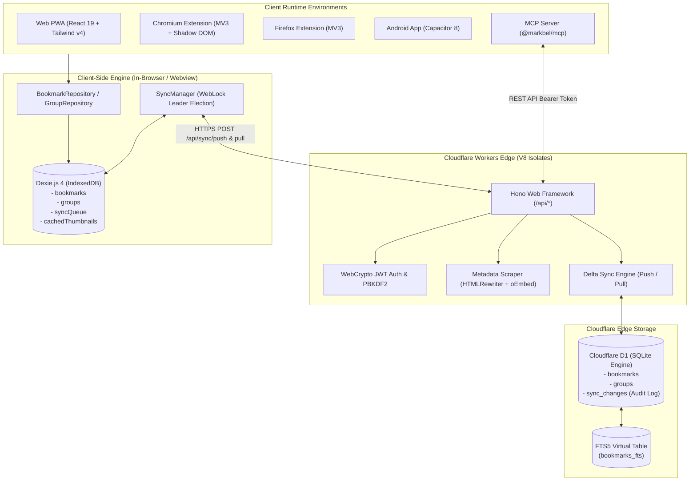
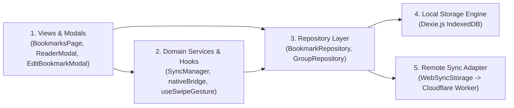
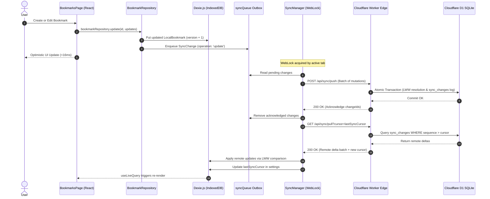

# Markbel — System Architecture & Technical Specifications

**Audience:** Software Engineers, System Architects & AI Agents  
**Status:** Canonical System Architecture  
**Version:** 2.9.4+ (November 2026)

---

## 1. High-Level System Topology

Markbel is a **Local-First, Zero-Latency, Distributed Bookmark Vault** designed to give users instantaneous access to their links and media bookmarks regardless of network connectivity.

---

## 2. Layered Clean Architecture

Markbel strictly enforces a unidirectional, layered clean architecture to isolate presentation, business rules, and persistence:

### Layer Contracts & Responsibilities

1. **View Layer (`src/views/`, `src/components/`):**
   - Pure presentation and user interaction.
   - Never accesses Dexie database instances directly; interacts exclusively via `bookmarkRepository` or reactive hooks (`useLiveQuery`).
   - Does not maintain network retry loops or synchronization state machines.

2. **Domain Service Layer (`src/sync/`, `src/lib/`):**
   - Coordinates business logic: Last-Write-Wins conflict resolution, series progression calculations, notification scheduling, and native device bridges (Haptics, Share, Keyboard).
   - Manages background tasks via WebLocks to ensure single-tab execution.

3. **Repository Layer (`src/db/`):**
   - Encapsulates all data access and mutation contracts (`create`, `update`, `delete`, `findById`, `listAll`).
   - Automatically enqueues pending mutations to the `syncQueue` outbox upon every write.
   - Enforces optimistic UI updates with immediate local commits.

4. **Storage Layer (`src/db/db.ts`):**
   - Dexie.js IndexedDB schema definition, indexing, and upgrade migrations.
   - Zero-latency local reads and writes.

5. **Edge Worker Backend (`worker/`):**
   - Headless Cloudflare Worker running Hono.
   - Authoritative database persistence in Cloudflare D1 SQLite.
   - Full-text search indexing via SQLite FTS5.
   - Edge-side metadata scraping and oEmbed resolution.

---

## 3. Storage Architecture & Data Flow

### Dexie.js (IndexedDB) Schema

The client database name is `MarkbelDB`. The schema is versioned sequentially:

| Store Name | Primary Key | Key Indexes | Purpose |
| :--- | :--- | :--- | :--- |
| `bookmarks` | `id` | `url, group, contentType, isPinned, isRead, remindAt, seriesKey, version, createdAt, updatedAt, deletedAt` | Authoritative local bookmark store |
| `groups` | `id` | `name, order` | Category groups / taxonomy pillars |
| `syncQueue` | `id` | `entityId, operation, timestamp` | Offline outbox of pending client mutations |
| `cachedThumbnails` | `url` | `fetchedAt` | Binary Blob thumbnail cache for instant offline rendering |
| `settings` | `key` | (none) | Local client preferences and token cache |

### Synchronization Flow (Push / Pull Protocol)

### Last-Write-Wins (LWW) Invariant

When resolving conflicting updates between client and server:
1. Compare `version`: Greater numeric revision wins.
2. If `version` is equal, compare `updatedAt` ISO 8601 timestamps: Later timestamp wins.
3. Soft-deleted records (`deletedAt IS NOT NULL`) always take precedence over older active edits.

---

## 4. Multi-Platform Distribution Architecture

### 1. Web Application & PWA
- **Stack:** React 19, TypeScript, Tailwind CSS v4, Vite 6, Workbox PWA.
- **PWA Capabilities:** Standalone display mode, offline asset precaching, Web Share Target API (`/share` route handling incoming links from other apps).
- **Virtualization:** TanStack Virtual (@tanstack/react-virtual) dynamic measurement for seamless infinite scrolling of 10,000+ bookmarks with responsive row height calculation.

### 2. Browser Extensions (Chromium & Firefox)
- **Manifest Version:** Manifest V3.
- **Chromium (`extension/manifest.json`):** Service worker background script, popup UI, content scripts, DeclarativeNetRequest rules.
- **Firefox (`extension/manifest.firefox.json`):** Background script with MV3 Firefox parity.
- **Alt+O Spotlight:** Injected in-page command palette mounted inside an isolated Shadow DOM (`#markbel-spotlight-root`) to prevent CSS and event leakage between host web pages and Markbel.

### 3. Native Mobile App (Capacitor Android)
- **Runtime:** Capacitor 8 with native Android runtime.
- **Plugins:** `@capacitor/app`, `@capacitor/haptics`, `@capacitor/keyboard`, `@capacitor/share`, `@capacitor/status-bar`.
- **Hardware Integration:** Native haptic ticks on interactions, automatic keyboard dismissal on feed scroll, system share sheet invocation.

### 4. Model Context Protocol (`@markbel/mcp`)
- **Transport:** Standard I/O (stdio) JSON-RPC protocol.
- **Agent Capabilities:** AI assistants (Antigravity, Claude Desktop, Cursor) can search, list, create, update, and delete bookmarks directly in the user's Markbel vault via bearer token authentication.

---

## 5. Critical System Invariants (Must Never Be Broken)

1. **Hardware Back Button Invariant:**
   - `useModalBackNavigation` must **NEVER** be mounted inside leaf components (such as `BookmarkCard.tsx`).
   - Hardware back button trapping is strictly reserved for page-level modals (`BookmarksPage.tsx` overlay state, `CommandPalette.tsx`, `ReaderModal.tsx`).
   - Leaf menus (3-dots action sheet / popover) manage dismiss state purely via local React state and backdrop clicks.

2. **React Portal Event Bubbling Invariant:**
   - Any popover, sheet, or overlay rendered via `createPortal(..., document.body)` must attach explicit `stopPropagation` listeners on `onPointerDown`, `onClick`, `onTouchStart`, and `onTouchEnd`.
   - Failure to stop propagation causes synthetic touch events to bubble up to the parent card element in React's component tree, triggering unintended card navigation or arming the 500ms long-press selection timer.

3. **Synchronous Action Callback Invocation:**
   - Button handlers in card action sheets must invoke their target domain callbacks (`onEdit`, `onDelete`, `onClick`, `onToggleRead`, etc.) **synchronously before or alongside** `closeMenu()`.
   - Calling `closeMenu()` first causes unmounts and cancels transient user activation tokens required for `window.open` and Web Share API.

4. **Edge-Swipe Navigation Invariant:**
   - The mobile sidebar navigation swipe gesture must strictly enforce edge-boundary detection (`edgeOnly: true`, `maxEdgeStartX: 36px`).
   - Gestures starting beyond 36px from the left physical bezel must pass through to horizontal scrolling components, tab carousels, and card grids without interception.

5. **Cloudflare D1 SQL Query Chunking Invariant:**
   - Cloudflare D1 enforces a maximum parameter limit per query. Any SQL query utilizing `WHERE id IN (...)` must chunk arrays into chunks of `<= 60` items (via `chunkArray()`).
