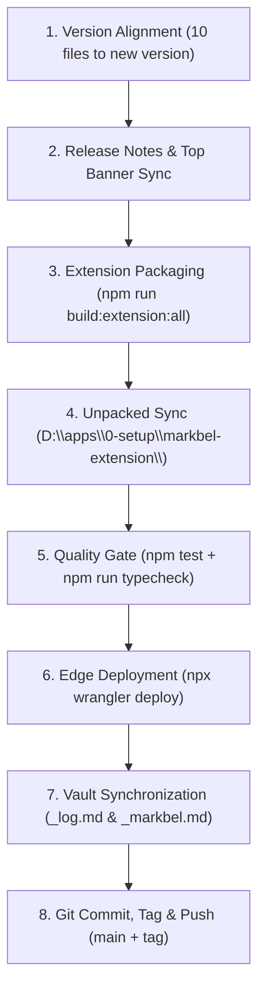

# Markbel — Complete Developer Guide & Engineering Runbook

**Audience:** Software Engineers & AI Agents Working on Markbel  
**Status:** Canonical Developer Guide  
**Version:** 2.9.4+ (November 2026)

---

## 1. Quick Start & Environment Setup

### Prerequisites
- **Node.js:** v18.0.0 or higher (v20+ recommended).
- **Package Manager:** npm v10+.
- **Shell:** PowerShell 7+ (`pwsh`) with `-NoProfile`.
- **Cloudflare Wrangler:** Pre-installed via devDependencies (`npx wrangler`).
- **Android Studio & SDK:** (Optional, required only for native Android APK builds).

### Installation & Local Dev

```pwsh
# 1. Install dependencies across root and MCP workspace
npm install

# 2. Run local development Vite dev server (defaults to http://localhost:5173)
npm run dev

# 3. In a separate terminal, run Cloudflare Worker edge API locally (optional)
npx wrangler dev
```

### Essential Quality Commands

```pwsh
# Run all 52 test suites (697+ unit tests)
npm test

# Run TypeScript compilation check (0 errors required)
npm run typecheck

# Build production bundle
npm run build

# Package browser extensions (Chromium & Firefox zips in dist/)
npm run build:extension:all
```

---

## 2. Bookmark CRUD Engineering Runbook

Every bookmark operation follows a strict unidirectional lifecycle: **UI -> BookmarkRepository -> Dexie.js (IndexedDB) -> SyncQueue Outbox -> Cloudflare Worker (D1 SQLite)**.

### A. Creating a Bookmark

```typescript
// Location: src/views/BookmarksPage.tsx
const handleAddBookmark = async (data: {
  url: string;
  title: string;
  description: string;
  image: string;
  group: string;
  remindAt?: string;
  isPinned?: boolean;
}) => {
  const newBookmark: LocalBookmark = {
    id: crypto.randomUUID(),
    userId: user?.id || "local-user",
    url: data.url,
    title: data.title || getDomain(data.url),
    description: data.description || "",
    image: data.image || "",
    group: data.group || "Unsorted",
    contentType: detectContentType(data.url),
    isPinned: Boolean(data.isPinned),
    isRead: false,
    version: 1,
    createdAt: new Date().toISOString(),
    updatedAt: new Date().toISOString(),
    deletedAt: null,
  };

  // 1. Persist immediately to Dexie.js & enqueue to syncQueue outbox
  await bookmarkRepository.create(newBookmark);

  // 2. Trigger asynchronous background sync
  syncManager.sync(true);
};
```

### B. Editing a Bookmark

```typescript
// Location: src/views/BookmarksPage.tsx
const handleEditBookmark = async (id: string, updates: Partial<LocalBookmark>) => {
  // 1. Update in local Dexie database
  // Note: bookmarkRepository.update increments version and updates updatedAt automatically
  await bookmarkRepository.update(id, {
    ...updates,
    updatedAt: new Date().toISOString(),
  });

  // 2. Trigger background sync
  syncManager.sync(true);
};
```

#### How to Add a New Field to Bookmarks (Complete Flow)
When introducing a new property to bookmarks (e.g. `readingProgressPercentage`):
1. **TypeScript Definitions:**
   - Update `LocalBookmark` interface in [`src/db/db.ts`](file:///d:/dev/projects/markbel/src/db/db.ts).
   - Update `BookmarkRow` interface in [`worker/src/types.ts`](file:///d:/dev/projects/markbel/worker/src/types.ts).
2. **Dexie Schema Migration:**
   - In [`src/db/db.ts`](file:///d:/dev/projects/markbel/src/db/db.ts), append a new version:
     ```typescript
     this.version(CURRENT_VERSION + 1).stores({
       bookmarks: 'id, url, group, contentType, isPinned, isRead, newField, version, createdAt, updatedAt, deletedAt'
     });
     ```
3. **Repository Mapping:**
   - Update [`src/db/BookmarkRepository.ts`](file:///d:/dev/projects/markbel/src/db/BookmarkRepository.ts) to handle the new field in `create` and `update`.
4. **Cloudflare D1 SQL Schema & Migration:**
   - Add column definition in [`worker/schema.sql`](file:///d:/dev/projects/markbel/worker/schema.sql).
   - Create migration file `worker/migrations/000X_add_new_field.sql`:
     ```sql
     ALTER TABLE bookmarks ADD COLUMN new_field TEXT DEFAULT NULL;
     ```
   - Execute migration remotely:
     ```pwsh
     npx wrangler d1 execute markbel-db --remote --file=./worker/migrations/000X_add_new_field.sql
     ```
5. **Worker Sync Route & Adapter:**
   - Update normalization and extraction in [`worker/src/routes/sync.ts`](file:///d:/dev/projects/markbel/worker/src/routes/sync.ts) and [`worker/src/normalize.ts`](file:///d:/dev/projects/markbel/worker/src/normalize.ts).
   - Update client adapter mapping in [`src/db/adapters/WebSyncStorage.ts`](file:///d:/dev/projects/markbel/src/db/adapters/WebSyncStorage.ts).

### C. Deleting a Bookmark (Soft Delete vs Hard Purge)

In Markbel's distributed architecture, bookmarks are **always soft-deleted** so that the tombstone replicates to all connected devices.

```typescript
// Correct: Soft-Delete (Tombstone Propagation)
await bookmarkRepository.update(bookmark.id, {
  deletedAt: new Date().toISOString(),
});
syncManager.sync(true);

// Hard Purge: ONLY used when wiping local guest data
// await bookmarkRepository.delete(bookmark.id);
```

### D. Toggling Read, Pin, and Series Progression

```typescript
// Pin / Unpin
const handleTogglePin = async (b: LocalBookmark) => {
  hapticSelection();
  await bookmarkRepository.update(b.id, { isPinned: !b.isPinned });
  syncManager.sync(true);
};

// Mark Read / Unread
const handleToggleRead = async (b: LocalBookmark) => {
  hapticSelection();
  const isRead = !b.isRead;
  await bookmarkRepository.update(b.id, {
    isRead,
    readAt: isRead ? new Date().toISOString() : "",
  });

  // If linked to a TickTick task, sync completion
  if (isRead && b.ticktickTaskId) {
    await syncCompletedBookmarkToTickTick(b);
  }
  syncManager.sync(true);
};

// Series +1 Progression
const handleAdvanceSeries = async (b: LocalBookmark) => {
  hapticImpact('medium');
  const nextInfo = parseSeriesProgression(b.url, b.title);
  if (!nextInfo?.nextEpisodeUrl) return;

  await bookmarkRepository.update(b.id, {
    url: nextInfo.nextEpisodeUrl,
    seriesEpisode: (b.seriesEpisode || 1) + 1,
    seriesHistory: [...(b.seriesHistory || []), { url: b.url, episode: b.seriesEpisode || 1, timestamp: new Date().toISOString() }],
  });
  syncManager.sync(true);
};
```

---

## 3. UI Component Architecture & Safe Navigation Invariants

### Component Hierarchy

```
App.tsx
├── BookmarksPage.tsx (Orchestrator View)
│   ├── LandingTopBanner.tsx (Version Announcement)
│   ├── NavigationHeader.tsx (Search, Filters, Sync Status)
│   ├── Sidebar.tsx (Category Pillars & Smart Groups)
│   ├── BookmarkCard.tsx (Leaf Component: List / Grid / Typography)
│   │   ├── BookmarkImage.tsx (Lazy Image / Blob Cache)
│   │   └── BookmarkMenuContent (3-Dots Action Sheet / Popover)
│   └── Page Modals (Centralized Overlay Manager)
│       ├── EditBookmarkModal.tsx
│       ├── DeleteModal.tsx
│       ├── ReaderModal.tsx
│       ├── CommandPalette.tsx (Alt+K)
│       └── ReleaseNotesModal.tsx
```

### The 4 Iron UI Rules

1. **Rule 1: NEVER Place `useModalBackNavigation` on Leaf Components:**
   - Leaf items (`BookmarkCard.tsx`) must manage menu visibility purely via local state (`isMenuOpen`) and backdrop clicks.
   - Centralize all back-button trapping in `BookmarksPage.tsx` using `useModalBackNavigation([...])`.
   - Reason: Having cards push `history.pushState` causes `history.back()` to fire on menu close, triggering `popstate` and instantly destroying newly opened page modals!

2. **Rule 2: Execute Action Callbacks Synchronously Before/With Dismiss:**
   - In `BookmarkMenuContent`, always call `onEdit(b)`, `onDelete(b)`, `window.open(...)`, or `shareUrl(...)` synchronously **before** or alongside `closeMenu()`.
   - Never call `closeMenu()` first; unmounting the button destroys transient browser user activation needed for `window.open` and Web Share.

3. **Rule 3: Stop Touch & Pointer Event Propagation on Portals:**
   - In `actionSheetPortal`, attach `onPointerDown`, `onClick`, `onTouchStart`, and `onTouchEnd` with `e.stopPropagation()` on both `sheetRef` and `popoverRef`.
   - Prevents menu touches from bubbling to the parent `<div onTouchStart={handleTouchStart}>` on the card underneath, avoiding accidental card selection or arming long-press timers.

4. **Rule 4: Edge-Swipe Mobile Drawer Detection:**
   - Keep `edgeOnly: true` and `maxEdgeStartX: 36px` on `useSwipeGesture` for opening the mobile sidebar.
   - Do not broaden the touch area to avoid intercepting horizontal feed scrolling or tab carousels.

---

## 4. Testing & Verification Guide

We use **Vitest** for all testing with strict AAA pattern (Arrange, Act, Assert).

```pwsh
# Run all tests once
npm test

# Run tests in watch mode during development
npx vitest

# Run a specific test suite
npx vitest run src/sync/ActionSheetButtonTouch.test.tsx
```

### Key Test Suites & Contracts
- `src/sync/ActionSheetButtonTouch.test.tsx`: Action sheet button executions, synchronous callback order, and decoupled history navigation.
- `src/components/BookmarkCardTouch.test.tsx`: Card click shields, transient ghost-click guards.
- `src/components/BookmarkCardSelection.test.tsx`: Hold-to-select long press and selection mode guards.
- `src/lib/useSwipeGesture.test.ts`: Edge-swipe finite state machine and start coordinate constraints.
- `src/sync/NetworkDegradation.test.ts`: Offline outbox, HTTP 504/429 recovery, and LWW cursor pull.
- `src/sync/WebLockResilience.test.ts`: Multi-tab synchronization and lock teardown safety.

---

## 5. Mandatory Release Lifecycle Protocol (Definition of Done)

Whenever any feature, fix, or enhancement is completed:



### The 10 Version Alignment Files
1. `package.json` (`"version": "X.Y.Z"`)
2. `packages/mcp/package.json` (`"version": "X.Y.Z"`)
3. `packages/mcp/src/index.ts` (`version: 'X.Y.Z'`)
4. `extension/manifest.json` (`"version": "X.Y.Z"`)
5. `extension/manifest.firefox.json` (`"version": "X.Y.Z"`)
6. `index.html` (`"softwareVersion": "X.Y.Z"`)
7. `public/llms.txt`
8. `public/llms-full.txt`
9. `src/components/landing/landingConstants.ts` (`CURRENT_VERSION = 'X.Y.Z'`)
10. `android/app/build.gradle` (`versionCode N`, `versionName "X.Y.Z"`)

### Permanent Download URLs (Never Hardcode Versions)
- Android APK: `https://github.com/belal-waheed/markbel/releases/latest/download/Markbel.apk`
- Firefox Extension: `https://github.com/belal-waheed/markbel/releases/latest/download/markbel-firefox-extension.zip`
- Chromium Extension: `https://github.com/belal-waheed/markbel/releases/latest/download/markbel-extension.zip`
